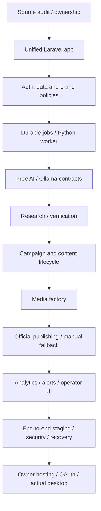

# Dependency map — gating and canonical ownership

**Hard prerequisites** live in `GATE_TRACKER.csv`; task-specific references live in `TASK_TRACKER.csv`. Every gate exit needs full acceptance evidence. G11 is outside the code-only scope and cannot be passed without actual owner environments.

## Shared state invariants

- Laravel/MySQL is the authority for `brand_id`, workflow job state, approval state, media checksums, channel tokens and publication history.
- Worker makes outbound HTTPS requests only; it never writes directly to remote DB or receives raw social OAuth credentials through general job payloads.
- OpenRouter free pricing and quota are validated before request and stored in authoritative ledger. Ollama is locally isolated.
- Research items never mark themselves verified; claims require evidence lineage and human verification for sensitive topics.
- Content revisions are immutable for approved publication; editing resets approval and invalidates dependent asset/package hashes.
- Publish idempotency is scoped to platform/account/content revision; unknown provider outcome leads to `needs_reconciliation`, not blind retry.
- Analytics metric definitions and snapshots have platform, source and captured time; cumulative vs delta semantics are explicit.
- Notification delivery is outbox-backed; operational logs exclude secrets and sensitive lead data.

## External vs code prerequisites

| Dependency | Available to engineering before owner setup | Final proof gate |
|---|---|---|
| Laravel framework code and lockfile | Yes | G01/G10 |
| MySQL-compatible integration CI | Yes, on CI/staging | G02/G10 |
| OpenRouter free catalog policy | Mock + current published docs | G04/G11 |
| CPU Ollama fallback | Stub + benchmark harness | G04/G11 |
| Source registry and safety | Public fixtures and mock DNS/robots | G05/G11 |
| Social adapters | Contract/mocked official responses | G08/G11 |
| Social scopes and app approvals | No; default manual-ready | G11 |
| Hostinger PHP/cron/document root | Preflight script ready; account result unknown | G11 |
| AadiPro catalog and Overseas allowlists | Configuration shell, no invented data | G11 |
| Media assets rights | Templates and fixtures only; actual licenses needed | G07/G11 |
